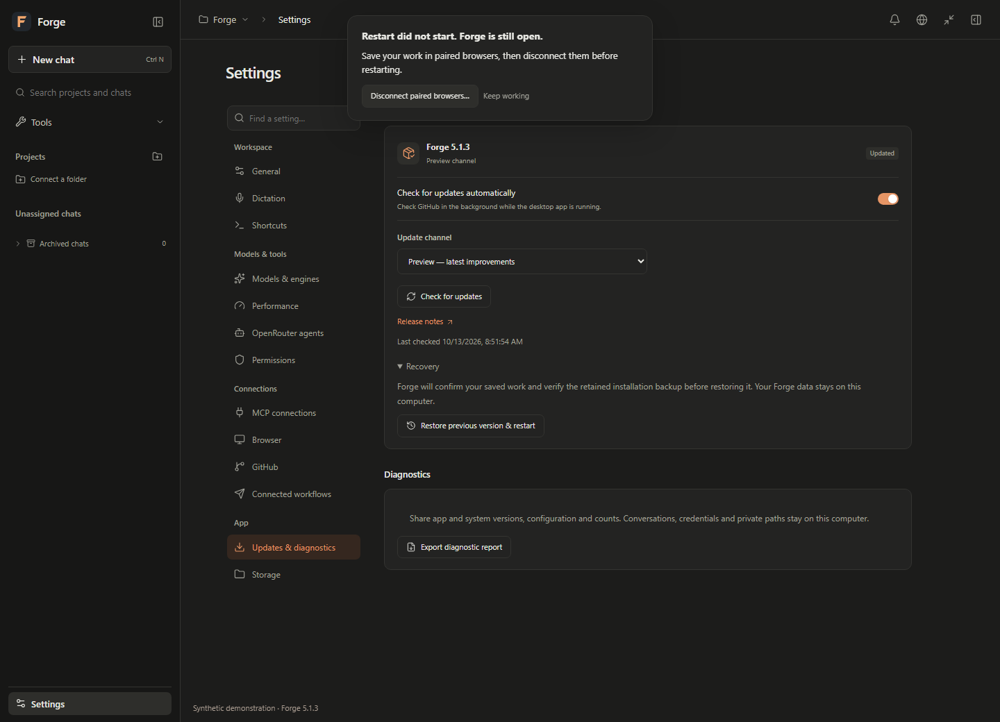

# Forge 5.1.3 Windows preview

This preview improves restart readiness and cloud-helper recovery. It preserves
Forge's conversation layout, colors, compact settings and project workflows.

## Saved work before a restart

The desktop update flow checks the current workspace and retained editors before
asking the app to exit. Drafts must be saved and confirmed against their exact
revision. Pending attachments, dictation, connection setup, Builder edits,
approvals and questions keep the app open until their work is resolved.

Restart preparation temporarily freezes edits. Two acknowledgements bind the
renderer to the same native attempt; a separate authenticated helper must be
ready before the app exits. Navigation, changed work, failed confirmation or a
late response cancels preparation. A stale response cannot cancel a newer
attempt. Failed preparation keeps a clear recovery action in the current panel.

Paired browser editors require an explicit disconnect before restarting. Forge
does not infer that a browser session has no unsaved work because its tab is
hidden or has stopped polling. Disconnecting does not erase its saved drafts.

The installer receives a one-use admission bound to the verified package,
application identity and committed attempt. It rechecks that identity at the
execution boundary. Cancellation can retry a failed journal write without
reusing a proof for another attempt. An uncertain installation remains available
for inspection instead of being reported as safely cancelled.

## Dictation and retained drafts

Saved speech is confirmed by scope, delivery identity and draft revision. A late
transcription cannot overwrite a deleted chat. Closing a view retains its draft;
an acknowledged deletion retires only that chat's retained work. Failed saves
keep the text available and keep restart preparation blocked.

## Clearer cloud-helper pauses

OpenRouter continuation failures include a bounded reason: insufficient context,
missing capabilities, an unavailable exact model or an unexpected model change.
Where available, activity shows the configured context and the returned model's
limit. These details survive reopening and appear in diagnostics without exposing
provider reasoning signatures or opaque state.

Forge keeps the configured context and profile. It does not guess an alias or
replay a completed tool action to work around a failed continuation. Optional
helpers can become unavailable while local work continues; required assignments
retain their blocked state.

These captures exercise the production UI with synthetic data. Task content and
available versions are fixtures; no private workspace or external account is
shown.

## Downloads, trust and recovery

GitHub detection, channel selection and publisher-authenticated downloads retain
the [5.1.2 trust model](FORGE_512.md#publisher-authenticated-downloads). The
read-only release verifier now installs its pinned runtime dependencies and
checks the exact requested tag. Windows executables still do not have an
Authenticode certificate.

The 5.1.2 seed requires a manual installation of this preview. Automatic checking
does not imply unattended installation. In-app apply and rollback remain closed
until the packaged authenticated forward and rollback checks have passed; the
release notes state the resulting capability and observed validation.

No database migration is added. Schema-7 workspaces, model files and credentials
remain in their existing locations. Keep the private installation and state
backups until the installed version is verified. Use the
[5.1 recovery notes](FORGE_51.md#verification-and-recovery) before reverting to a
schema-6 application.
