# Earlier Forge previews

These images and animations use an isolated demo workspace with synthetic data.

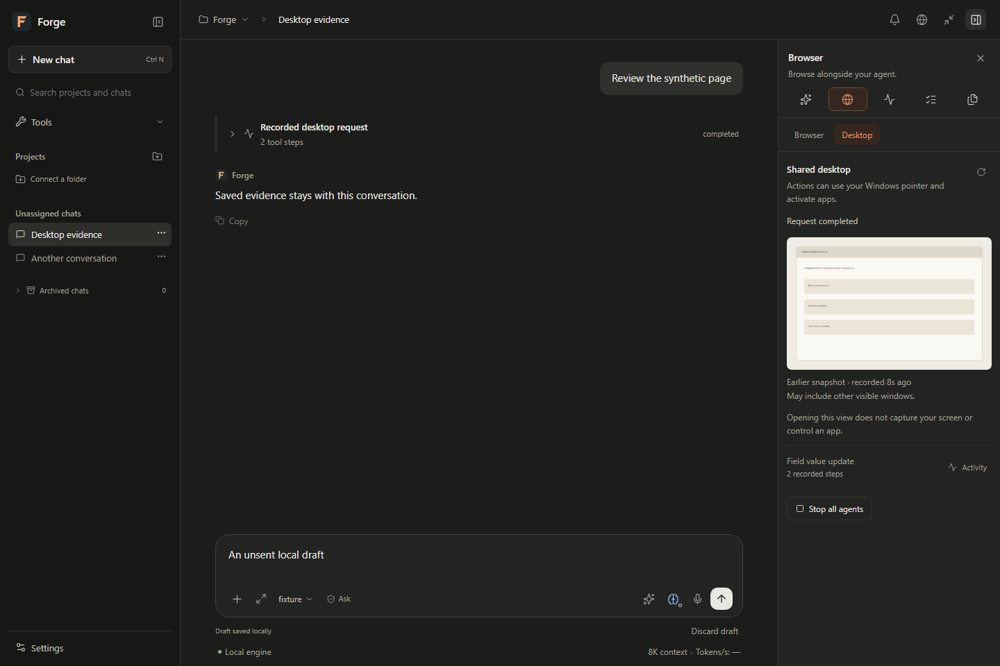

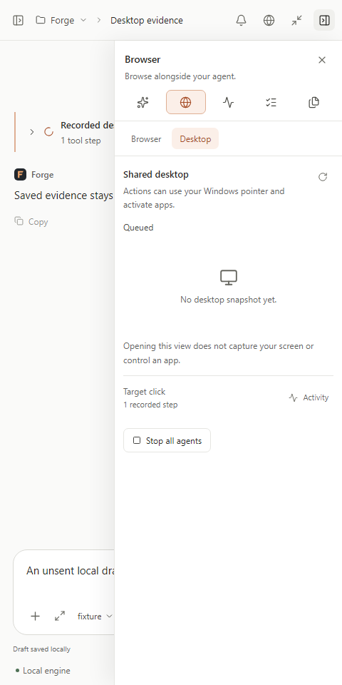

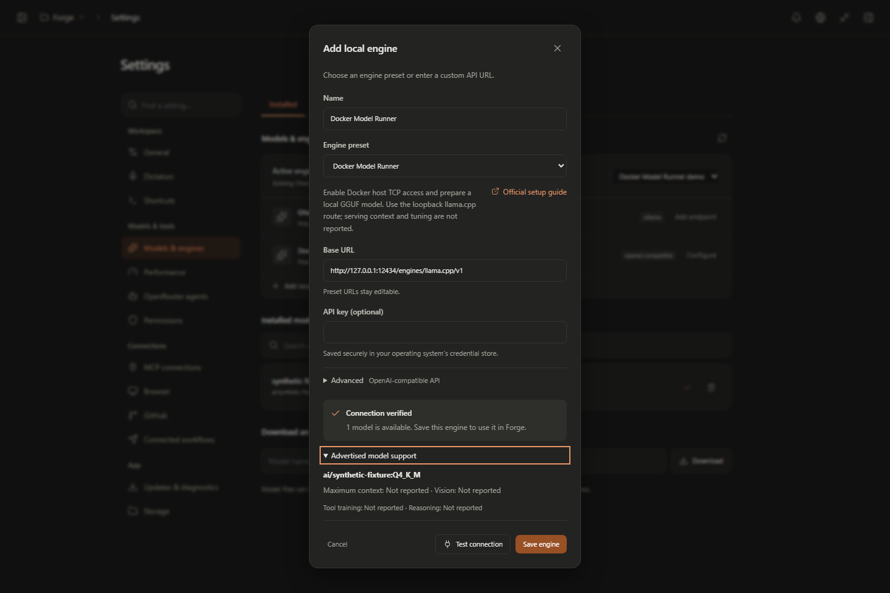

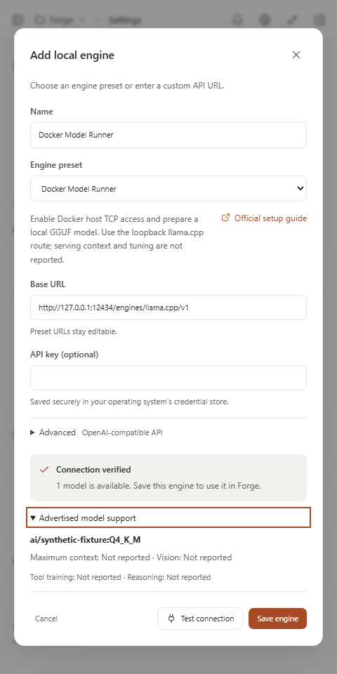

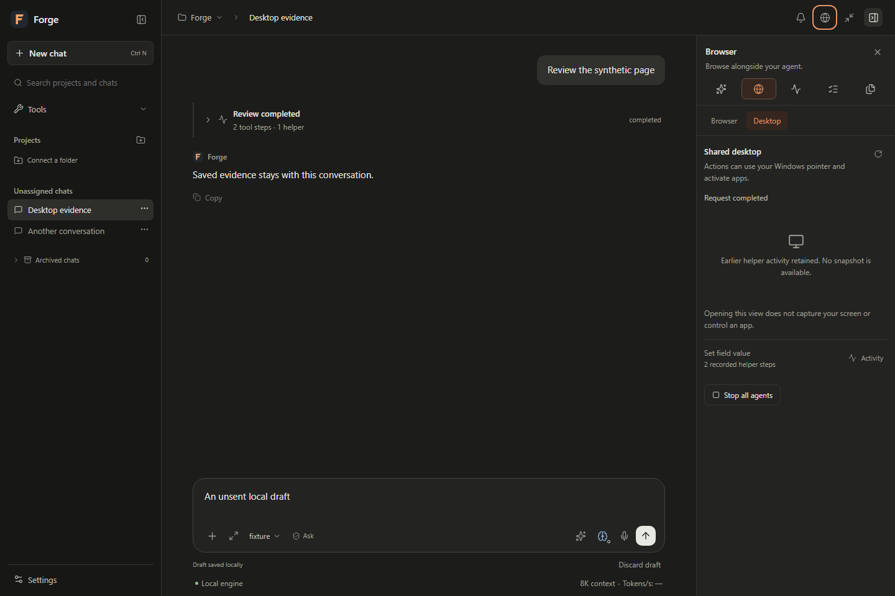

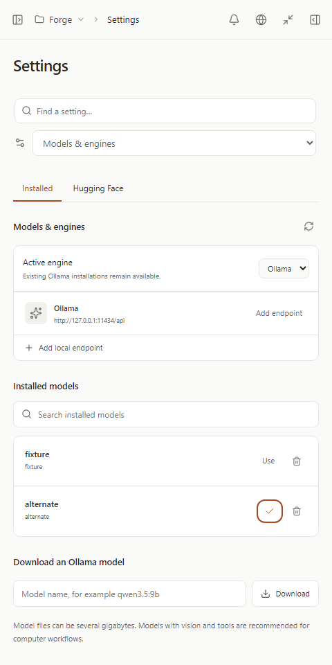

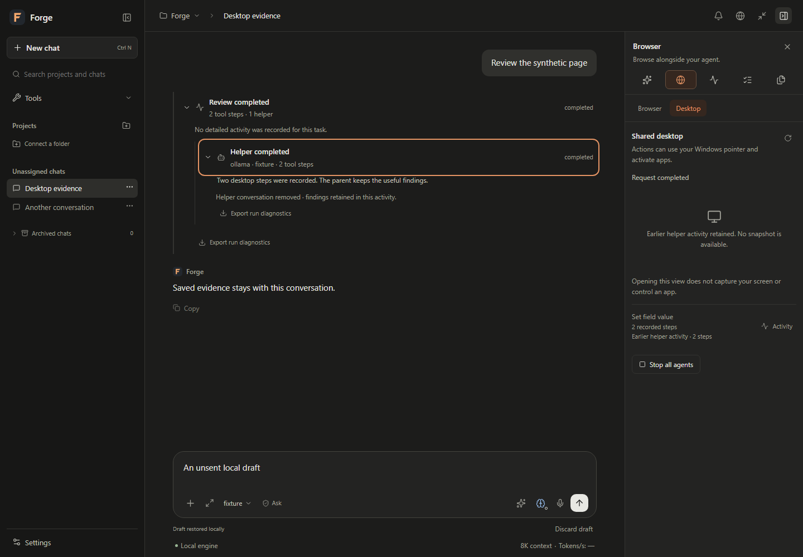

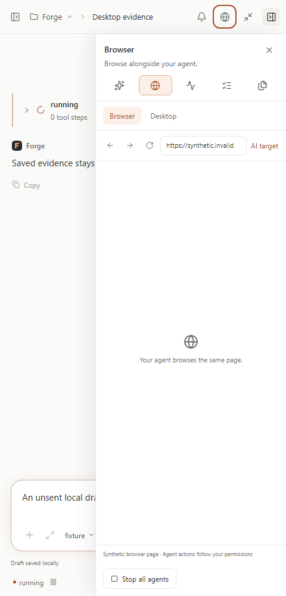

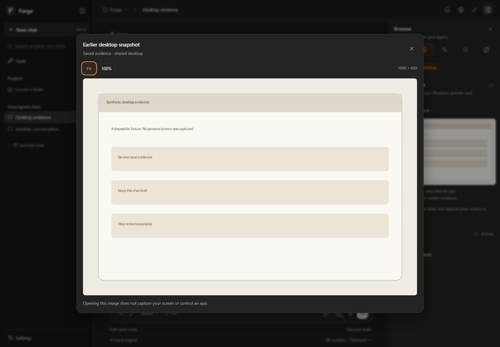

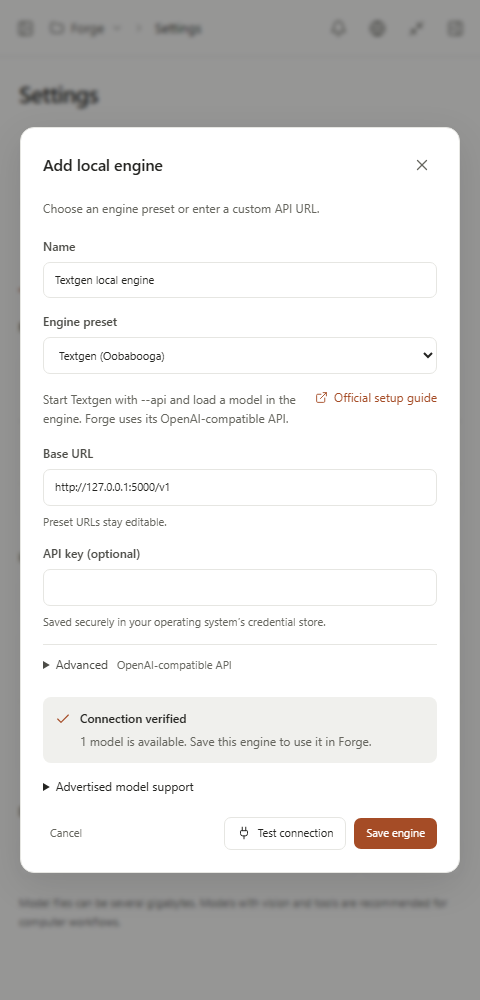

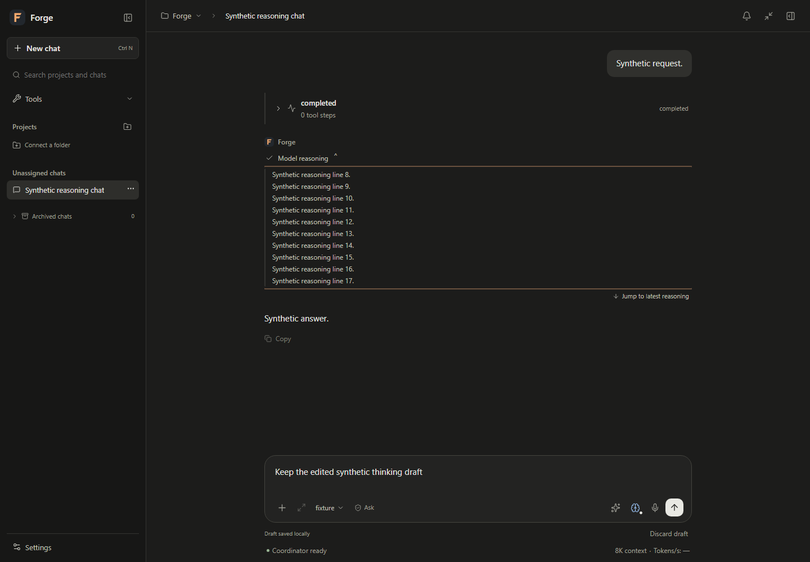

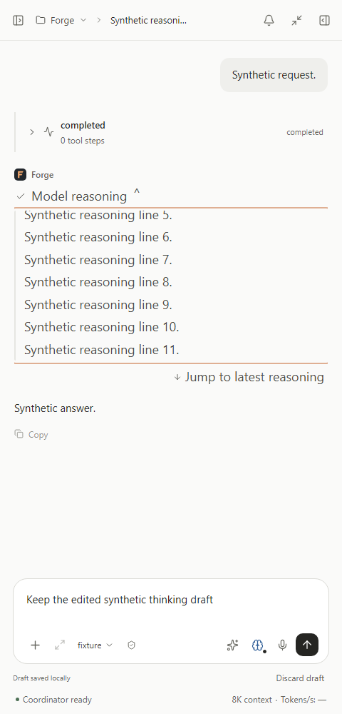

Watch the workspace and Builder in action

Attach guidance for your next message:

Move from the brief to the preview and checks:

